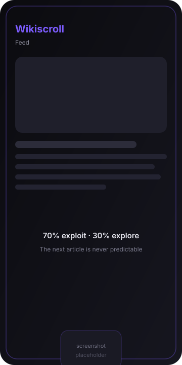
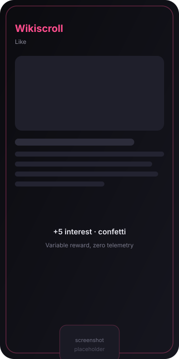
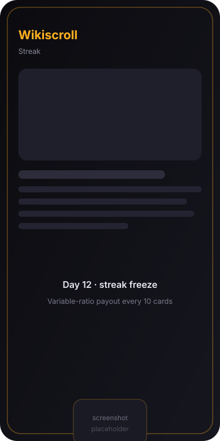

# Wikiscroll

An infinite Wikipedia feed, ranked on-device by what you actually read.

[](https://kotlinlang.org)
[](https://www.jetbrains.com/compose-multiplatform/)
[](LICENSE)
[](#project-layout)

## Overview

Wikiscroll is a Wikipedia client with no search box. Every swipe loads one article from the neighbourhood of the previous one: its internal links, its categories, and the categories the reader keeps returning to. Ranking runs on the device from reading behaviour, not from profile data.

Most feed products optimise for time spent on content that leaves nothing behind. Wikiscroll applies the same mechanics to a corpus that does: full-screen cards, one gesture per item, and a reward the reader cannot predict. The loop is documented rather than hidden. The event weights, the exploration split and the payout table below are the specification the engine is tested against.

This repository is an Apache-2.0 fork of [WikWok](https://github.com/terrakok/WikWok) by Konstantin Tskhovrebov.

## Core Features

- **Dopamine-driven recommendation algorithm.** A variable-ratio schedule drives the feed: exploitation of high-interest categories most of the time, unpredictable exploration the rest. The reward is the article, and the interval is never announced.
- **Dwell-aware interest model.** Reading time, not clicks, is the primary signal. Articles that hold attention raise the weight of their categories; articles swiped past in under 1.5 seconds lower it.
- **Daily streaks.** Consecutive-day reading is tracked as `(lastVisitEpochDay, streak)`, so time zones and daylight-saving changes cannot break it.
- **Variable ratio rewards.** Every tenth article pays out from a weighted table. The interval is fixed and the payout is not - the classic variable-ratio shape, applied to knowledge instead of slot reels.
- **Random walk navigation.** The next card is sampled from the current article's graph neighbourhood, so a session reads as a train of thought instead of a slot machine.
- **Multiplatform by construction.** One Compose Multiplatform UI, one shared domain layer, four targets: Android, iOS, desktop (JVM) and web (Wasm).
- **No account, no telemetry.** Scores live in local storage. There is no analytics SDK in the dependency graph and no server to send them to.

## Screenshots

<p align="center">
  
  
  
</p>

<p align="center"><em>Placeholders. Real device captures land with the Phase 3 UI work.</em></p>

## Algorithm Architecture

Three interaction events feed a persisted score per category. There is no other input.

| Event | Condition | Weight |
|---|---|---|
| `DwellTime` | article visible for >= 8.0 s | **+2** |
| `FastSwipe` | advanced in < 1.5 s | **-1** |
| `LikeAction` | explicit tap | **+5**, confetti burst |
| none | 1.5 s to 8.0 s | 0 - deliberate dead zone |

The timer starts when the pager settles on a page and stops on scroll-away, so prefetching cannot inflate it.

```text
UserInterestScore(c) = max(0, sum of weights of every event on an article in category c)
P(c)                 = UserInterestScore(c) / sum(UserInterestScore(.))
```

The floor at zero matters: a category can be pushed down to nothing, but never blacklisted. One good article brings it back.

### The 70/30 split

```text
draw one uniform number per article

  0.00 - 0.70  EXPLOIT  sample a category weighted by P(c)
  0.70 - 1.00  EXPLORE  sample a category the reader has never seen
```

Exploitation alone converges on the first three categories that ever scored and the feed collapses into a niche. The 30 % exploration arm exists to break that local maximum and to reset the response: a reward you can predict stops working as one. When the unseen pool empties, exploration falls back to cold categories (score > 0, no event in the last N articles) before degrading to pure exploitation. That exhaustion path is a test case, not an afterthought.

### Random walk

```text
candidates = internal links(current) + categories(current)
weight(x)  = 1 + 0.5 * UserInterestScore(category(x))
next       = weighted sample from candidates, excluding the session history
```

The walk is reversible, produces no repeats inside a session window, and only jumps globally on a dead end - an article with no usable links.

### Variable ratio rewards

Every tenth article draws from a weighted table. The interval is fixed; the outcome is not.

| Payout | Probability |
|---|---|
| Cosmetic badge | 55 % |
| Streak freeze (protects one missed day) | 20 % |
| Deep dive: five articles from one high-score category | 15 % |
| Rare theme unlock | 9 % |
| Jackpot: full confetti and a rare badge | 1 % |

### Reference implementation

```kotlin
fun next(current: Article, state: InterestState, rng: Random): Article {
    val pool = if (rng.nextDouble() < 0.30) state.unseenCategories() else state.topCategories()
    if (pool.isEmpty()) return current.neighbours().maxBy { state.score(it.category) }

    val target = pool.weightedSample(rng) { state.score(it) }
    return current.neighbours()
        .filter { it.category == target && it.id !in state.sessionHistory }
        .maxByOrNull { state.score(it.category) }
        ?: current.neighbours().random(rng)
}
```

## Project Layout

```text
Wikiscroll/
  androidApp/     Android entry point
  desktopApp/     JVM desktop entry point
  iosApp/         Xcode project and SwiftUI host
  webApp/         Wasm browser entry point
  sharedUI/       product logic and UI (Compose Multiplatform)
    data/         Wikipedia API client, persistence, platform services
    domain/       RecommendationEngine, InterestState, rewards   (Phase 2)
    ui/           feed screen, dwell instrumentation, confetti   (Phase 3)
    theme/        Material 3 theming
```

Dependencies point one way: presentation reads domain, domain requires data, and data never sees Compose. The domain layer is plain Kotlin with a seedable `Random`, so the whole policy is testable without a device or a network.

## How to Build

Requires JDK 17 or newer, and an Android SDK for the Android target.

```bash
# Android
./gradlew :androidApp:assembleDebug

# Desktop (fastest iteration loop)
./gradlew :desktopApp:run

# WebAssembly
./gradlew :webApp:wasmJsBrowserDevelopmentRun

# Shared tests
./gradlew :sharedUI:allTests
```

For iOS, open `iosApp/iosApp.xcodeproj` in Xcode and run the `iosApp` scheme. If the Android SDK is not configured globally, add a `local.properties` with `sdk.dir=...` at the repository root.

## Roadmap and Contributing

Background research and the full task breakdown live in [docs/RESEARCH.md](docs/RESEARCH.md) and [docs/IMPLEMENTATION_PLAN.md](docs/IMPLEMENTATION_PLAN.md).

- [x] **Phase 1 - Fork and identity.** Apache-2.0 fork, remotes wired, README and algorithm specification.
- [ ] **Phase 2 - Recommendation engine.** `RecommendationEngine`, `InterestState`, 70/30 policy, interaction weights, random walk, streak and reward tables. Pure `commonTest` suite with a seeded RNG.
- [ ] **Phase 3 - Feed UI.** `WikiscrollScreen` on `VerticalPager`, settle-aware dwell timer, confetti on like, reward reveal every tenth article.
- [ ] **Phase 4 - Persistence and polish.** Interest vector in KStore, cold-start bootstrap, offline cache, accessibility pass.

Contributions are welcome once Phase 2 lands, since the domain layer will then have a stable contract and a test suite to extend. Until then the useful work is discussion: open an issue with the mechanism you want to change and the evidence behind it.

Two ground rules for pull requests. Every behavioural change needs a test that fails without it. Any change to the event weights or the payout table needs a short note in the pull request explaining the expected effect on reading time.

## License and Attribution

Apache License 2.0. The upstream `LICENSE` is preserved verbatim; modifications are recorded in [NOTICE](NOTICE) as required by sections 4(b) and 4(d).

Wikipedia content is served by the Wikimedia REST API under CC BY-SA 4.0. Every card carries the article title, its language and a link to the canonical page.

Wikiscroll is not affiliated with or endorsed by the Wikimedia Foundation.

## Scope and Ethics

This is an engineering study of engagement mechanics, published as a portfolio artifact. It is not a monetised product.

The following are design commitments rather than roadmap items:

- No telemetry. Every signal is computed and stored on-device.
- No push notifications. The loop never reaches out; the reader starts every session.
- Bounded prefetch. The pager buffers a window instead of running the network in the background.
- Gamification is a setting that can be switched off.
- No generated content. Text and images come from Wikipedia and are attributed.

The mechanics are documented here precisely because they are effective. Hiding them would be the worse choice.
